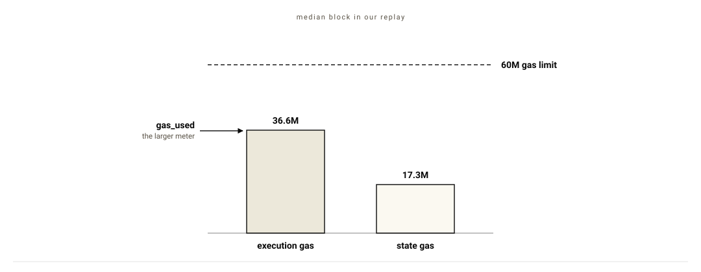

*Thanks to EthLabs for their feedback on this post.*

Apart from the 2022 move to proof of stake, most of the banks and custodians we talk to have not followed Ethereum's forks. Since London in 2021, the gas limit has doubled from 30M, and the forks have changed what accounts and rollups can do. Of the next two forks, Glamsterdam is mostly about capacity. Hegotá turns to account control and to who decides what goes into a block.

The Merge moved the chain to proof of stake in September 2022, which cut its energy use by about 99.95% ([ethereum.org](https://ethereum.org/en/roadmap/merge/)). Staked ETH became withdrawable with Shapella in April 2023 ([EIP-4895](https://eips.ethereum.org/EIPS/eip-4895)). Rollups, the L2 chains that settle on Ethereum, got blobs, a data space of their own, with Dencun in March 2024. Median fees on the largest of them fell by roughly 90 to 98% within days ([DL News, from growthepie data](https://www.dlnews.com/articles/defi/ethereums-dencun-upgrade-cuts-layer-2-fees-as-much-as-98/)). Pectra followed in May 2025 with smart account code for existing addresses ([EIP-7702](https://eips.ethereum.org/EIPS/eip-7702)) and validators of up to 2,048 ETH ([EIP-7251](https://eips.ethereum.org/EIPS/eip-7251)). Validators raised the gas limit to 60M through 2025 ([pumpthegas.org](https://pumpthegas.org/)). Fusaka added a built-in check for P-256 signatures, the curve passkeys use, that December ([EIP-7951](https://eips.ethereum.org/EIPS/eip-7951)).

Glamsterdam forked the Sepolia testnet on 6 October, with mainnet planned for December 2026 ([protocol priorities](https://blog.ethereum.org/2026/09/07/protocol-priorities)). Its consensus headline, ePBS, moves the auction between block builders and validators into the protocol ([EIP-7732](https://eips.ethereum.org/EIPS/eip-7732)). Block access lists ship alongside it so that clients can verify a block's transactions in parallel ([EIP-7928](https://eips.ethereum.org/EIPS/eip-7928)). Hegotá follows in 2027 by [forkcast](https://forkcast.org/)'s planning estimate, with frame transactions and FOCIL scheduled. Frame transactions let an account choose its own signature check and gas payer ([EIP-8141](https://eips.ethereum.org/EIPS/eip-8141)). Under FOCIL, a committee of validators can force waiting public transactions into the next block ([EIP-7805](https://eips.ethereum.org/EIPS/eip-7805)). Ten-second slots, down from 12, are under consideration for Hegotá as well ([EIP-8198](https://eips.ethereum.org/EIPS/eip-8198)). Further out, the roadmap targets cryptography that resists quantum computers by December 2029. Research aims to cut finality, the point after which a block can no longer be reverted, to seconds.

![A timeline runs from 2021 to 2029. Filled markers show what shipped: London with its 30M gas limit, the Merge with proof of stake, Shapella with withdrawals, Dencun with blobs, Pectra with smart account code, the 60M gas limit and Fusaka with P-256 checks. A line marks October 2026. Outlined markers show Glamsterdam with ePBS and block access lists in December 2026, and Hegotá with frame transactions and FOCIL in 2027. Dashed markers to the right of Hegotá show 10-second slots under consideration and research on finality in seconds. A marker at the far right shows the December 2029 quantum target.](../assets/posts/2026-10-19-upcoming-eips/timeline.svg)

*Figure 1: Ethereum's upgrades from London to the post-quantum target.*

Each upgrade above shipped to a live chain. Glamsterdam, the next fork, prepares clients for a gas limit of 200M. It also charges more for writing new storage, which raises the gas cost of most transactions we replayed. Hegotá moves key control and gas payment into the protocol. FOCIL, also in Hegotá, makes it harder for a few builders to keep a transaction out. The roadmap after Hegotá includes finality in seconds and a quantum-resistant chain by the end of the decade. None of it gives you confidentiality from the RPC provider and the builder that see your transaction. That is still work for contract code and off-chain systems, which is where we spend our time.

The sections below follow what those banks and custodians need: keys, capacity at a plannable cost, speed to finality, neutral inclusion and confidentiality. Each section opens with a short summary for six kinds of firms: a bank treasury, a financial market infrastructure (FMI) such as a payment or securities settlement system, a custodian, a transfer agent, a stablecoin issuer and a staking provider. The cheatsheet at the end compares Glamsterdam and Hegotá for each of them.

## Keys and account control

**In short**

- **Bank treasury:** since Fusaka, a smart account can check a P-256 signature from a key held in a bank's hardware security module.
- **FMI:** No material change.
- **Custodian:** ETH moved by contract code gets a log entry with Glamsterdam. Frame transactions in Hegotá let an account choose its own signature check and gas payer. An account that requires an assertion frame ([EIP-7906](https://eips.ethereum.org/EIPS/eip-7906), considered for Hegotá) would have rejected the first transaction of the Bybit attack.
- **Transfer agent:** a fund can pay gas for an investor's transfer through frame transactions in Hegotá.
- **Stablecoin issuer:** USDT, which lacks `permit` and [ERC-3009](https://ercs.ethereum.org/ERCS/erc-3009), gets sponsored transfers through frame transactions in Hegotá.
- **Staking provider:** No material change.

A custodian needs control over which keys can move funds, and under what limits. Most Ethereum accounts are still externally owned accounts (EOAs), each controlled by one key on secp256k1, the curve Ethereum has used since launch. A spending limit or a second signer has meant moving funds into a smart contract wallet such as [Safe](https://safe.global), at a new address. With an [EIP-7702](https://eips.ethereum.org/EIPS/eip-7702) delegation, an EOA runs smart account code under the address that allowlists and compliance records already point to. The delegated contract gets full control of the account, which makes delegation requests a phishing target.

Passkeys sign with P-256, a standard NIST curve that bank hardware security modules (HSMs) also support. A smart account has been able to check such a signature for 6,900 gas since Fusaka, which lets a key held in that hardware approve a transfer directly.

Frame transactions build these controls into the transaction format ([EIP-8141](https://eips.ethereum.org/EIPS/eip-8141)). A frame transaction is a list of up to 64 frames, each a call with its own gas limit. Validation comes first, in `VERIFY` frames that run the account's own code with state writes disabled. That code ends by calling `APPROVE`, which can approve payment as well as execution. The contract that approves payment pays the gas. `SENDER` frames then carry out the account's calls. Addresses with no code get a built-in secp256k1 check, which lets today's EOAs send frame transactions without migrating. In a frame transaction, `ORIGIN` returns the address that called the frame, which breaks contracts that use `tx.origin == msg.sender` as an EOA check. Wallets have to estimate gas per frame.

The EIP's own example uses frames for gas sponsorship. A user pays gas in USDC through a sponsor, whose `VERIFY` frame approves payment after reading the USDC fee transfer in the next frame. The frames up to that approval form the validation prefix. An optional last frame lets the sponsor run follow-up logic, such as a swap to ETH. The receipt records who paid.

*Figure 2: the EIP's sponsored USDC example, frame by frame.*

Sponsors like this one meet a limit in the public mempool, where most transactions wait for a builder. A sponsor contract can have one pending transaction there at a time. Sponsoring at scale goes through the EIP's canonical paymaster, a reference sponsor contract, or through a plain EOA whose pending sponsorships stay within its balance. The canonical paymaster approves on one secp256k1 signature, without looking at the fee transfer. USDT, which lacks the `permit` and [ERC-3009](https://ercs.ethereum.org/ERCS/erc-3009) functions USDC uses for gasless transfers, gets sponsored transfers at the protocol level this way.

Frames also change what a failed policy check costs. Today, a smart contract wallet that blocks a transfer still lands a reverted transaction with its gas paid. A frame transaction that fails `VERIFY` is invalid in any block. Public mempool nodes run `VERIFY` against the sender's own storage. An allowlist kept in another contract is out of reach there. A transaction that depends on such a check goes to a builder directly, outside the public mempool that FOCIL draws on.

Each account orders its transactions with a nonce, a counter that rises by one per transaction. Keyed nonces, considered for Hegotá, give one sender many independent counters ([EIP-8250](https://eips.ethereum.org/EIPS/eip-8250)). The EIP's leading example is a privacy protocol whose users share one sender address, where one user's inclusion invalidates the others' pending withdrawals. The public mempool still allows one pending frame transaction per sender.

Bybit lost about $1.5B in February 2025 after its signers approved a contract upgrade disguised as a normal transfer ([Sygnia](https://www.sygnia.co/blog/sygnia-investigation-bybit-hack/)). WazirX and Radiant lost about $235M and $50M. In each of the three, the first signed transaction changed an implementation slot or an owner slot. [EIP-7906](https://eips.ethereum.org/EIPS/eip-7906), considered for Hegotá, lets a frame transaction end with an assertion about its net changes, from balances and storage slots to emitted events. An assertion that no implementation or owner slot changes would have rejected the first transaction in each attack.

The protocol leaves the assertion optional. An account has to require its own assertion frame in `VERIFY`, with bounds set in advance, because whoever controls the signing screen can drop an assertion or loosen it. By our reading of the incident reports, a Safe Guard that blocks `delegatecall` before a Safe transaction runs could have stopped the Bybit and WazirX transactions. Safe's [Guardrail](https://safefoundation.org/blog/safe-research-guardrail-locking-down-delegate-calls) is one such guard. Fireblocks and Safe would have to adopt frame transactions before custodians could use 7906, which puts it in 2027 at the earliest. Assertions are written into the transaction's public input data, where anyone watching the chain can read a treasury's outflow limits.

Frame transactions also give smart accounts a way off ECDSA, the signature scheme behind secp256k1 keys, which a large enough quantum computer breaks ([post-quantum threats](/domains/post-quantum/) on our map). An account can verify a post-quantum signature in its `VERIFY` code, within the frame's gas limit. Rotating to the new key leaves its address unchanged. An EOA keeps a secp256k1 key that can still sign ordinary transactions and token permits, whatever code it delegates to.

*Figure 3: account control from 2021 to the post-quantum key.*

On the receiving side, Glamsterdam gives ETH moved by contract code a log entry, the way ERC-20 transfers already have ([EIP-7708](https://eips.ethereum.org/EIPS/eip-7708)). ETH sent from a smart account leaves no log today. The EIP's authors point to early exchanges that missed such deposits or credited them late.

## Capacity and cost

**In short**

- **Bank treasury:** a transaction sent with a gas limit from before Glamsterdam can run out of gas after the fork. In our replay, 209 of 255 mainnet transactions failed this way. Gas limits set in your gateway or custody signing policy need updating before December.
- **FMI:** Glamsterdam prepares clients for a gas limit of 200M.
- **Custodian:** an emptied deposit address pays the new-holder price on each refill. A dust balance keeps the refill at 53,960 gas against 140,264. Wallets with a hard-coded 21,000 gas limit fail on transfers to new addresses.
- **Transfer agent:** a dividend run that writes new storage slots for each holder used about 2.4 times today's gas in our replay. Updating existing entries in place prices each write at 12,100 gas against 97,920. 
- **Stablecoin issuer:** under Glamsterdam, a USDC transfer to a new holder uses 2.44 times today's gas.
- **Staking provider:** the gas limit your validators signal after Glamsterdam decides whether transactions end up cheaper than today.

Settlement has to work on a busy day, at a cost you can plan for. Scaling the blob capacity has been in service of this goal. Dencun set the blob target at 3 per block. Pectra doubled it to 6 in May 2025. PeerDAS, which shipped with Fusaka, lets a node confirm that blob data is available by sampling pieces of it ([EIP-7594](https://eips.ethereum.org/EIPS/eip-7594)). Two blob-parameter forks after Fusaka raised the target to 10 in December 2025 and 14 in January 2026 ([Fusaka announcement](https://blog.ethereum.org/2025/11/06/fusaka-mainnet-announcement)).

The L1 gas limit has stayed at 60M since November 2025 ([Checkpoint 9](https://blog.ethereum.org/2026/04/10/checkpoint-9)). Core developers confirmed 200M for Glamsterdam, once the repricing numbers were final ([ACDE #243](https://forkcast.org/artifacts/acde/2026-08-13_243/key_decisions.json)). Sepolia's validators start voting the limit toward 200M at the fork, while mainnet's value after the fork is still open ([ACDE #246](https://forkcast.org/artifacts/acde/2026-09-24_246/key_decisions.json)). Several changes in Glamsterdam let the limit rise that far, including block access lists and the repricing. A block access list names the accounts and storage slots a block touches, with their values after execution. With the lists, a client reads state and executes transactions in parallel, which keeps a 200M block within the time a slot allows. Executing them one after another is about three times slower ([ACDE #246](https://forkcast.org/artifacts/acde/2026-09-24_246/key_decisions.json)).

*Figure 4: the gas limit and the blob target since 2021.*

The repricing keeps state growth in check as the limit rises. The number that surprised us most in this research came from [ethPandaOps state data](https://lab.ethpandaops.io/ethereum/execution/state-expiry) as of 1 October. XEN, a token minted for the price of gas, holds 166.7 million of mainnet's 1.66 billion storage slots, about 10% of the total and 3.8 times the slots of USDT and USDC combined. Between December 2025 and March 2026, the months with the cheapest gas, 40% of all new slots went to XEN.

A storage slot, one 32-byte entry in a contract's storage, costs gas once today, at the write, with nothing charged for keeping it. [EIP-8037](https://eips.ethereum.org/EIPS/eip-8037) keeps the one-off charge at a much higher price: 1,530 gas per byte of new state, tuned for 120 GiB of growth a year at a 150M gas limit. A new storage slot goes from 20,000 gas to 97,920.

The charge lands on a separate meter, state gas, which keeps state creation from crowding out computation in the block. Each block reports the larger of its two meters as `gas_used`. The base fee, the per-gas price the protocol sets, follows that number. In our replay, the median block at today's 60M limit carried 36.6M of execution gas against 17.3M of state gas.

*Figure 5: the two meters of the median block in our replay.*

For a plain transfer, the change comes through [EIP-2780](https://eips.ethereum.org/EIPS/eip-2780), which splits the flat 21,000 base cost by resource. A transfer to an existing account still costs 21,000 in total. Zero-value calls get cheaper, at 15,000. ETH sent to an empty address is the expensive case, because the transfer now pays 183,600 state gas to create the account. That brings it to 204,600 gas, 9.7 times what it costs today.

[EIP-8038](https://eips.ethereum.org/EIPS/eip-8038) reprices access to state that already exists, with a write to an existing cold slot going from 5,000 gas to 12,100. USDC and USDT add roughly 350,000 to 400,000 new balance slots a day on mainnet, by our estimate from a 43-block sample. Exchanges and custodians often give each client its own deposit address. The odd part is what happens after a sweep. Emptying the address sets its token slot to zero, which returns no state gas. Each refill then writes that slot again as new state, at the price of a transfer to a new holder. Leaving a dust balance behind keeps the slot non-zero, which prices the refill as a transfer to an existing holder: 53,960 gas against 140,264 in the replay below.

In wallet code, the first thing to break is gas estimation. A transfer to a new address with a hard-coded 21,000 limit runs out of gas after inclusion, with its fee still charged. Estimators also need a second dimension for state gas.

### Replaying the gas changes

We replayed 255 mainnet transactions through geth against their captured pre-state. Under today's rules, all 255 matched mainnet gas. The Glamsterdam run used a raised gas limit to keep transactions from running out of gas. We also replayed 48 recent blocks, 12,531 transactions, through a shared gas pool, where 98.4% of transactions matched mainnet exactly. Sent with their original gas limits, 209 of the 255 transactions fail under Glamsterdam, as do 41% of the transactions in the replayed blocks.

| Transaction | Gas today | Gas under Glamsterdam | Ratio |
| - | -: | -: | -: |
| [USDC to an existing holder](https://etherscan.io/tx/0xa1f4aac4e64ea51f45afe2abb4942e71bcf87de52c4a689f3b6564e8e93bf5cc) | 45,160 | 53,960 | 1.19x |
| [USDC from a sender emptying its balance](https://etherscan.io/tx/0x47abaf1a56663e14e024352eae32100d46fecf8495304adf0ec826e7613c886c) | 40,360 | 43,168 | 1.07x |
| [USDC to a new holder](https://etherscan.io/tx/0x71d83d62648c049d2b0ca70e5d472cdb55f63c3baf10d72396cdbaa9aab55fe8) | 57,460 | 140,264 | 2.44x |
| [ETH to a fresh address](https://etherscan.io/tx/0xda449807d1f52210b0d06ef7ade822b963fa18ad45544f7fce266b4c3c2d74c7) | 21,000 | 204,600 | 9.7x |
| [BUIDL daily dividend](https://etherscan.io/tx/0x2ded00f9bfd5639fe1e568d0c843437d65e337b72449a892ce7da29bd5d18800) | 4,854,334 | 11,648,314 | 2.40x |
| [CMTAT token to an existing holder](https://etherscan.io/tx/0x03afa700a3f1e2b8bb662ae629a3071eda345e548cd0bac78a1ea9051737615a) | 59,367 | 68,567 | 1.15x to 1.17x |
| [CMTAT token to a new holder](https://etherscan.io/tx/0xfc7a10b5f23a04a02f8b92d118f6f4c702dd68dae2f0695b167256155d2119bd) | 76,455 | 166,475 | 2.16x to 2.32x |
| [T-REX issuance to existing holders](https://etherscan.io/tx/0xa18b87d7073546e6491b1d5e353cd1b118f8b13f38a9738c0190f98a20a80380) | 415,959 | 512,159 | 1.22x to 1.23x |
| [T-REX issuance to new holders](https://etherscan.io/tx/0xbc5ecfd8da7072627376d1355db93027084f831be7afc9c1db2fe6bac4ca5ab6) | 545,985 | 1,222,325 | 2.13x to 2.63x |
| [T-REX investor onboarding](https://etherscan.io/tx/0xb42deb3647df849b8c11a62bccae4020c631e97bb436758ba4abc01932fd1567) | 604,757 | 2,430,265 | 4.02x |
| [Railgun transfer](https://etherscan.io/tx/0xf520d47bd3a631133a47c0e1e01c6e3553bf9171635db5f2e76371fbafcfd463) | 1,109,404 | 1,460,864 | 1.24x to 1.32x |
| [Privacy Pools relayed withdrawal](https://etherscan.io/tx/0x01c1e4bf65310ff5b842c43f449df5450a367db8493437df475ed42e0cf37ce3) | 604,466 | 1,027,506 | 1.46x to 1.88x |
| [ERC-7984](https://ercs.ethereum.org/ERCS/erc-7984) [confidential transfer](https://etherscan.io/tx/0x223eca270a092a2dd7cac990a4e28a15c72acfdf61bc1423df9d9833f5f59b69) | 450,628 | 1,088,068 | 2.36x to 2.47x |

*Each row links one replayed transaction. Its gas values are from that transaction. Ratio ranges cover the transactions we replayed for that row. Replayed with geth v1.17.7.*

The increases follow storage writes, with each new slot adding about 87,920 gas more. The daily dividend of BUIDL, BlackRock's tokenized money market fund, is [one `bulkIssuance` call](https://etherscan.io/tx/0x2ded00f9bfd5639fe1e568d0c843437d65e337b72449a892ce7da29bd5d18800) to 33 holders that creates 69 new storage slots. BUIDL's compliance contract takes 66 of them for its issuance log, two per holder for each dividend. Updating one log entry per holder in place would price those writes as writes to an existing slot: 12,100 gas against 97,920 for a new one.

The block replay shows the base fee moving as well. The median block's execution gas rises 23%, because EIP-8038 makes writes and cold access more expensive and [EIP-7778](https://eips.ethereum.org/EIPS/eip-7778) stops refunds from reducing a block's counted gas. Counting state gas, users pay for 1.75 times as much gas in the median block. Forty of the 48 blocks land above the 30M target, half the limit, up from 25 today, which pushes the base fee up about 4% per block on average. Five of the blocks would no longer fit under 60M.

At 60M the fork raises users' costs. How far validators take the gas limit after the fork decides whether it ends up cheaper.

*Cost scenarios: taking the 2026 median gas price of 0.683 gwei (billionths of an ETH) and ETH at $2,110, a transaction at 2.44 times the gas breaks even once the gas price falls to 0.28 gwei. At 200M, with prices falling in proportion to 0.205 gwei, seven of the eight rows in the table cost less than today. ETH to a fresh address is the exception, at $0.089 against $0.030 today.*

## Speed and finality

**In short**

- **Bank treasury:** the Fast Confirmation Rule confirms a block within about one slot, with no fork needed. Finality itself takes about 15 minutes today.
- **FMI:** 10-second slots, considered for Hegotá, shorten the wait for inclusion. A new consensus model is the leading candidate for I*, the fork that follows Hegotá. It should cut finality from about 15 minutes to 4 minutes or less.
- **Custodian:** No material change.
- **Transfer agent:** No material change.
- **Stablecoin issuer:** No material change.
- **Staking provider:** No material change.

Slots have been 12 seconds long since the Merge. Finality takes about 15 minutes ([Vitalik Buterin's notes](https://notes.ethereum.org/@vbuterin/single_slot_finality)). A treasury desk that settles on finality waits that long today. The [Fast Confirmation Rule](https://fastconfirm.it/) needs no fork. It was [merged into the consensus specifications](https://github.com/ethereum/consensus-specs/pull/4747) in April. A client running it confirms a block within about one slot, as long as messages reach validators on time. The client returns that block for the `safe` block tag. When messages arrive late, a confirmed block can still be reorged without any validator being slashed. Settlement policy should use the `finalized` tag when the Fast Confirmation Rule does not meet your risk model.

Quick Slots, considered for Hegotá since 1 October, turns slot length into a setting ([EIP-8198](https://eips.ethereum.org/EIPS/eip-8198)). Gas limits and blob counts scale down per slot with it, which keeps throughput per second constant. The proposed length is 10 seconds ([ACDC #188](https://forkcast.org/artifacts/acdc/2026-10-01_188/key_decisions.json)). The cut from 12 still needs validation before core developers schedule it for Hegotá.

A new consensus model, which separates finality from block production, is the leading candidate for I*, the fork that follows Hegotá ([protocol priorities](https://blog.ethereum.org/2026/09/07/protocol-priorities)). We expect it to cut finality from about 15 minutes to 4 minutes or less. The [strawmap](https://strawmap.org), a draft roadmap of upcoming forks, puts one-round finality in 2029 or 2030.

*Figure 6: what a treasury desk waits for between sending a transfer and finality.*

## Neutrality and inclusion

**In short**

- **Bank treasury:** from Hegotá, a committee of validators can force your waiting public transaction into the next block.
- **FMI:** under ePBS in Glamsterdam, a slot can carry a beacon block with no executed payload. Settlement monitors have to wait for the payload.
- **Custodian:** No material change.
- **Transfer agent:** No material change.
- **Stablecoin issuer:** FOCIL in Hegotá gives your freeze transaction the inclusion guarantee. A listed transfer from a frozen address still reverts in the token contract.
- **Staking provider:** MEV-Boost relays keep working after Glamsterdam. From Hegotá, attesters vote against a block that skips a listed transaction, whichever relay delivered it. We found no regulator statement on FOCIL.

A stablecoin transfer needs to reach a block whichever firm builds it. A validator chosen to propose a block, the proposer, rarely builds it today. About 91% of blocks arrive through MEV-Boost relays ([mevboost.pics](https://mevboost.pics), late September). Three builders produce about 88% of all blocks ([relayscan](https://www.relayscan.io/)). A builder is a firm that orders a block's transactions for MEV, the profit available from ordering them. The relay exists because builder and proposer have no reason to trust each other. The builder hands the relay its full payload with a bid attached. The proposer signs a block header without seeing the payload, trusting the relay to publish the block and pay the bid.

Under ePBS ([EIP-7732](https://eips.ethereum.org/EIPS/eip-7732)), the proposer puts a builder's signed bid, a block hash with the value owed, into the beacon block, the consensus half of the block. The builder reveals the execution payload after the beacon block is out. A Payload Timeliness Committee (PTC) of 512 validators then votes on whether the payload arrived on time with its blobs. Builders stake on the beacon chain for this, from as little as 1 ETH. That balance pays the bid even when the builder withholds the payload.

*Figure 7: one slot under ePBS, with the MEV-Boost relay path for comparison.*

Splitting the block this way gives validators more time. Attesters, the validators that vote on each block, check the consensus part of the block before voting, which moves payload execution later in the slot. The split also creates a slot with a beacon block and no payload, which the EIP calls empty. The proposer still gets paid for an empty slot. A settlement monitor that treats a beacon block as confirmation would count unexecuted transactions as settled.

MEV-Boost keeps working after Glamsterdam. Figment's [post on Glamsterdam](https://www.figment.io/insights/glamsterdam-what-ethereums-next-upgrade-means-for-institutional-stakers/) describes "no forced migration" for relay setups, since the ePBS builder market is opt-in. A staker's relay keeps deciding whether sanctioned transactions get filtered until FOCIL arrives in Hegotá.

FOCIL ([EIP-7805](https://eips.ethereum.org/EIPS/eip-7805)) takes part of that decision away from builders. In each slot, a committee of 16 validators builds inclusion lists from what each member sees in its own mempool, up to 8 KiB per list. The lists go out over gossip, the network's peer-to-peer broadcast, during the slot. Attesters check that the next block satisfies the lists before voting for it. A block that leaves out a valid listed transaction goes unattested.

The guarantee is conditional. A block may skip a listed transaction when the transaction fails its nonce or balance check at the end of the block, or when the block has no gas left. The builder can place listed transactions anywhere in the block, which leaves it in charge of ordering and the MEV that comes with it. Committee members earn nothing for the work, since the design counts on one honest member out of 16 being enough. FOCIL lists are built from the public mempool, which leaves out transactions sent to builders privately.

*Figure 8: one round of FOCIL, from slot N to slot N+1.*

FOCIL changes what a staker's choice of relay controls. Figment routes through relays that comply with OFAC, the US sanctions office, by default ([Figment](https://www.figment.io/insights/compliance-at-the-core-why-ofac-compliant-mev-relays-matter-for-institutional-ethereum-stakers/)). Coinbase offers an OFAC-screening relay option. About 22% of relay payloads went through OFAC-filtering relays on 28 September ([mevwatch.info](https://www.mevwatch.info/)). Under FOCIL, an attester checks the block against the inclusion lists whichever relay delivered it. A committee member can keep sanctioned transactions off its own list. Any of the other 15 can still list them. A regulated staking provider that proposes a filtered block gets it rejected, because attesters vote against a block that skips a listed transaction while it has room.

The legal position for US stakers is open. The Senate vote to advance the CLARITY Act, which carried a safe harbour for people running nodes, failed 49 to 50 on 15 September. OFAC has published nothing on validators. We found no regulator statement on FOCIL.

FOCIL also touches the freeze function that the GENIUS Act requires of a stablecoin ([§4(a)(6)](https://www.govinfo.gov/content/pkg/BILLS-119s1582enr/html/BILLS-119s1582enr.htm)). A listed transfer from a frozen address still gets included, where the token contract reverts it. The issuer's own freeze transaction gets the inclusion guarantee too.

## Who can read a transaction

**In short**

- **Bank treasury:** through Hegotá, the RPC provider and anyone watching the chain can read your transfers' counterparties and amounts. Keeping them private is work for contract code and off-chain systems.
- **FMI:** No material change.
- **Custodian:** Glamsterdam's ETH transfer logs add to what anyone can read about client deposits.
- **Transfer agent:** No material change.
- **Stablecoin issuer:** No material change.
- **Staking provider:** No material change.

The RPC provider that receives a USDC transfer reads its counterparties and amount first. From there, the public mempool and the chain itself show them to anyone who looks. Nothing scheduled for Glamsterdam or Hegotá changes this. The ETH transfer logs from EIP-7708 add to what anyone can read.

Core developers did look at confidentiality in the protocol for Hegotá. A proposal for private ETH and ERC-20 transfers through a [shielded pool](/patterns/pattern-shielding/) built into the protocol was declined on 10 September ([EIP-8182](https://eips.ethereum.org/EIPS/eip-8182)). Encrypted mempools, which hide a transaction's contents from builders until it is included, were proposed for Hegotá too. Their leading design, LUCID, was turned down as a headliner in March ([forkcast](https://github.com/ethereum/forkcast/blob/main/src/data/eips/8184.json)). The strawmap now places encrypted mempools in its longer-term column.

*Figure 9: who reads a USDC transfer on its way to the chain.*

Hegotá's considered list has two changes written for shielded pools, contracts that hold funds as encrypted notes. Besides keyed nonces, it has recent roots, which let a frame prove a spend against a recent root of the pool's commitment tree, the running list of its notes ([EIP-8272](https://eips.ethereum.org/EIPS/eip-8272)).

In June we planned this kind of spend, with a pool user paying gas and submitting directly through a frame transaction ([hardened shielded pools](/writeups/exploring-hardened-shielded-pools/)). That plan runs into the public mempool's limit of 100k gas for the validation prefix. A single-note spend needs at least 211,828 gas of validation, by [mmjahanara's count on ethresear.ch](https://ethresear.ch/t/25889). A spend of that size stays out of the public mempool that FOCIL committees build their lists from, which leaves a relayer, a third party that submits the spend and pays its gas, in place. The ethresear.ch post asks for a limit of at least 250k. Raising the cap is still under discussion.

The privacy rows in the replay table show what the repricing does to these systems, since each spend leaves a permanent nullifier, the record that stops a note being spent twice, and a withdrawal to a fresh address creates an account. We expect new pools to launch on L2s as a result. [Forced exits](/patterns/pattern-forced-withdrawal/) from a privacy L2 to mainnet gain FOCIL's inclusion guarantee.

Keeping contents from the parties in Figure 9 is left to contract code and off-chain systems, which is the work our [map](/approaches/approach-private-payments/) and proofs of concept cover. Each of those designs also needs a way to show an auditor one transaction without the rest ([selective disclosure](/patterns/pattern-regulatory-disclosure-keys-proofs/)).

A pool on mainnet still exposes data around its notes. Deposit and withdrawal amounts are public. A withdrawal that matches a deposit in size and timing can link the two. The receipt records the account that pays a spend's gas, which is why the June plan kept the gas payer apart from the spender. The IP address of whoever submits a spend reaches the RPC provider unless the submission goes through a [network anonymity system](/patterns/pattern-network-anonymity/).

## Further out

**In short**

- **Bank treasury:** the keys for a 30-year bond need to survive a quantum computer. A smart account can switch to post-quantum signatures through frame transactions, at an unchanged address.
- **FMI:** optional proofs, proposed for Hegotá, let your systems check chain state against a proof. Today they trust an RPC provider's answer.
- **Custodian:** the roadmap targets cryptography that resists quantum computers by December 2029. Moving client accounts over takes years beyond that.
- **Transfer agent:** No material change.
- **Stablecoin issuer:** No material change.
- **Staking provider:** validators move from BLS to hash-based signatures, which the strawmap places in 2029 or 2030.

A 30-year bond issued in 2026 matures in 2056. The keys that hold it need to survive a quantum computer arriving at any point in those 30 years. The target for quantum resistance across execution, consensus and data is December 2029 ([protocol priorities](https://blog.ethereum.org/2026/09/07/protocol-priorities)). The plan swaps BLS, the signature scheme validators vote with, for hash-based signatures ([pq.ethereum.org](https://pq.ethereum.org)). The strawmap places the fully hash-based chain in 2029 or 2030. Moving accounts over is expected to take years beyond that. A smart account holding the bond can switch to post-quantum signatures through frame transactions.

Validators check a block today by executing its transactions again. A zkVM, a system that proves a program ran correctly, lets them check a short proof in its place. By December 2025, zkVMs were proving 99% of mainnet blocks in under 10 seconds on target hardware ([zkEVM security foundations](https://blog.ethereum.org/2025/12/18/zkevm-security-foundations)). Security work on the provers is still under way ([ethproofs](https://ethproofs.org)). Optional proofs are proposed for Hegotá ([EIP-8025](https://eips.ethereum.org/EIPS/eip-8025)). With proofs, a bank's own systems could check chain state against a proof in place of an RPC provider's answer. Mandatory proofs come later on the strawmap, around 2029.

## Cheatsheet

Taken one EIP at a time, several of the changes above come with a cost, from wallets that have to re-estimate gas to stakers whose relay no longer decides what gets filtered. Across the forks since London, the protocol has kept taking over work that existed outside it: smart account code with Pectra, the P-256 check with Fusaka, the builder auction with ePBS and inclusion lists with FOCIL. The table below compares the next two forks for each kind of firm in this post.

Statuses are as of 6 October 2026, from forkcast and the meta EIPs for each fork ([EIP-7773](https://eips.ethereum.org/EIPS/eip-7773), [EIP-8081](https://eips.ethereum.org/EIPS/eip-8081)).

| Firm | Glamsterdam, December 2026 | Hegotá, 2027 |
| - | - | - |
| Bank treasury | A transaction sent with a gas limit from before the fork can run out of gas. Gas limits in gateway and custody signing policies need updating before December. | An account can choose its own signature scheme. Counterparties and amounts remain public. |
| FMI | A slot can carry a beacon block with no executed payload. Settlement monitors have to wait for the payload. | A committee of validators can force waiting public transactions into the next block. |
| Custodian | Gas estimates need a state gas dimension, with no hard-coded 21,000 limit. A dust balance keeps a deposit address refill at 53,960 gas against 140,264. | Frame transactions move signing policy into account code. A required assertion frame (considered) would have prevented some hacks in the past. |
| Transfer agent | A dividend run that writes new storage slots for each holder used about 2.4 times today's gas in our replay. Entries updated in place cost 12,100 gas per write against 97,920. | A fund can pay gas for an investor's transfer through frame transactions. |
| Stablecoin issuer | A transfer to a new holder uses 2.44 times today's gas. | USDT gets sponsored transfers through frame transactions. FOCIL gives your freeze transaction the inclusion guarantee. |
| Staking provider | MEV-Boost relays keep working. The gas limit your validators signal decides whether transactions end up cheaper. | Attesters vote against a block that skips a listed transaction while it has room. We found no regulator statement on FOCIL. |
