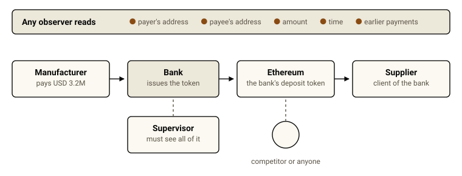

Privacy vendors pitch banks one technology at a time. Comparing the technologies is left to the bank. What the bank wants is a client's payment kept confidential from competitors and the public, and fully readable by the bank and its supervisor. For a payment in a tokenized deposit, a bank deposit issued as a token on Ethereum, the technologies differ most on whether the public can still see who paid whom. Some work like a sealed envelope with the sender and the recipient written on the outside. The rest put the names inside the envelope too. The bank's first decision is whether names on the outside are acceptable.

This post follows one payment. A manufacturer pays USD 3.2M to a supplier that is also a client of its bank, in that bank's tokenized deposit. Payments between a bank's own clients are the simplest flow to pilot first. On Ethereum today the payment travels like a postcard. Anyone can read who paid whom and how much, and look up the earlier payments between them ([Figure 1](#figure-1)). A competitor watching the manufacturer's account learns who supplies it and how much it spends. For this payment, the bank's risk team may decide that the names need to go inside the envelope.

*Figure 1: One payment in a tokenized deposit on Ethereum today. Any observer reads what the bank's supervisor reads.*

The second decision is who can open the envelope. A supervisor asks the bank for its payment records. The core banking system does not see payments that clients make to each other with the token, so the bank needs to open those envelopes to answer. With some technologies the bank holds the key itself. With others it asks a committee of key holders, or the firm that runs the hardware, to open the envelope for it. Once the bank has made these two decisions, its first question to any vendor is which parties can read or stop a payment in its product.

Five families of privacy technology on Ethereum answer these two decisions differently, and many products combine more than one. In their usual designs, **[fully homomorphic encryption (FHE)](/patterns/pattern-private-shared-state-fhe/)** and **[multi-party computation (MPC)](/patterns/pattern-private-shared-state-cosnark/)** leave the names on the outside of the envelope. **[Shielded pools](/patterns/pattern-shielding/)**, **[privacy L2s](/patterns/pattern-privacy-l2s/)** (separate chains that settle on Ethereum) and **[trusted execution environments (TEEs)](/patterns/pattern-tee-based-privacy/)** put the names inside. Who holds the key depends on the design as much as on the family.

At EthSystems, the team behind the Ethereum Foundation's Institutional Privacy Task Force, we maintain the [Ethereum Privacy Map](/map/). It covers [24 use cases](/drilldown/). For some of them, such as payments, it compares [several approaches](/approaches/approach-private-payments/) and rates how far each one has come. We also build [starter kits](https://github.com/ethsystems/pocs) for four of these families, and publish benchmark numbers for the ones we could measure. Across that work, we have found that different approaches suit different banks, depending on what their compliance and risk teams require. The sections below compare the five families on business fit, on regulation and compliance, and on performance and cost. They end with the questions to put to a vendor.

## The five families

Each family seals the payment in a different place and adds its own parties for the bank to trust.

- **Shielded pools** hold the bank's deposit tokens in a pool contract on Ethereum and keep each client's balance as a sealed note. To the public the pool looks like an omnibus account, with money going in and coming out. Payments between clients inside the pool stay sealed. A relayer submits payments and pays the gas. The bank opens the notes through selective disclosure, with a read-only key that the design gives it. What that key shows depends on the design, and in some designs it shows the payments a client received but not whom the client paid.
- **Privacy L2s** keep their accounts sealed by default. Clients move deposit tokens onto one through a bridge, and a sequencer puts the payments in order. Think of a branch that keeps its own books and sends head office a sealed summary.
- **FHE** lets a network of computers add and subtract balances while they stay encrypted, like a clerk who balances the books without opening the envelopes. A committee of key holders opens a balance on request. Enough of its members acting together can open all of them.
- **TEEs** open and process payments inside an enclave, a sealed area of a processor. Whoever runs the machine cannot look inside by design, and the chip maker vouches that the enclave runs the code it claims. The map notes that a TEE resists physical tampering less than an HSM and has a larger attack surface, with a documented history of side-channel attacks.
- **MPC** splits each payment into shares held by several independent nodes, which process it together. This is MPC applied to the payment itself, separate from the MPC wallets that banks use to hold signing keys. No single node sees the whole payment, much as a vault can need several keyholders present. Enough nodes acting together can see everything.

[Figure 2](#figure-2) opens up each family in turn, to show the parties it adds.

![Five panels, one per family, each with a contract on Ethereum and the parties around it. Shielded pool: a pool contract holds the bank's deposit tokens, the bank reads notes by selective disclosure, and a relayer submits payments and pays gas. Clients hold notes in the pool. Privacy L2: a bridge contract holds the bridged deposit tokens, the bank reads its records by selective disclosure, and a sequencer puts payments in order. Accounts on the L2 stay sealed. FHE: a token contract keeps balances encrypted, an FHE network computes on them, and a key committee decrypts on request. Payer and payee addresses stay public. TEE: a settlement contract checks the enclave's result, the bank or a cloud provider hosts the hardware, and a chip maker vouches for the enclave. Payments are opened inside the enclave. MPC: a settlement contract checks the nodes' result, and node operators hold shares of each payment and compute together. Payer and payee addresses stay public in most setups.](../assets/posts/2026-11-19-privacy-solution-families/families.svg)

*Figure 2: The five families, opened up one at a time. Each shaded box is a party the bank adds to its list of third parties.*

## The comparison

A bank that wants the names inside the envelope has three families to choose from, and each carries a cost. With a shielded pool or a privacy L2, the client's position moves into an omnibus structure, held as a claim on the pool or the separate chain. With a TEE, the bank takes on third-party risk on the chip maker that keeps payments sealed. [Table 1](#table-1) compares the usual design of all five families on business fit, regulation and cost, and shows only where they differ.

| | Shielded pool | Privacy L2 | FHE | TEE | MPC |
|---|---|---|---|---|---|
| **Business fit** | | | | | |
| *Payer and payee, seen by the public* | Hidden inside, visible on entry and exit | Hidden inside, visible on entry and exit | Visible | Hidden | Visible |
| *Amount, seen by the public* | Visible on entry and exit | Visible on entry and exit | Hidden | Hidden | Hidden |
| **Regulation and compliance** | | | | | |
| *Who opens the envelope for the supervisor* | The bank | The bank | A key committee | The enclave, through its disclosure code | The bank, with a scoped proof from the nodes |
| *Third parties the bank adds* | Relayer | Sequencer and bridge | FHE network and key committee | Chip maker, and the host if a cloud provider runs it | Node operators |
| *Main risk* | A bug in the proof system or contract. A small pool leaks through timing. | Bridge hack | Committee collusion exposes all balances | Chip flaw exposes payments | Node collusion exposes payments |
| **Performance and cost** | | | | | |
| *Cost per payment* | High | Low, plus fees to move money on and off | Set by the FHE network | Varies | Medium |
| *Fixed running costs* | A relayer | A sequencer and bridge for its own L2, none on a shared one | An FHE network and key committee, run or paid for | Enclave hosting | A node committee, run or paid for |
| *If a third party goes offline* | Payer's address becomes visible | Payments stop. Clients can withdraw on Ethereum if the L2 has a forced exit | Payments stop, balances cannot be opened | Payments stop | Payments stop |

*Table 1: The five families in their usual designs. Source: the [private payments approach](/approaches/approach-private-payments/) and the pattern pages on the Ethereum Privacy Map.*

## Business fit

With a shielded pool or a privacy L2, privacy depends on volume. Deposits into the pool and withdrawals from it still travel like postcards, with the amount and time readable by anyone. Any product that wraps the bank's public deposit token shows the same amounts on entry and exit, whatever its family. If the manufacturer puts USD 3.2M in and the supplier takes USD 3.2M out an hour later, a competitor can match the two. In a busy pool, with many clients and steady flows, that match gets much harder, in the same way one client is hard to pick out of a large omnibus account. A bank choosing either family should plan to bring enough clients into the pool and have them keep balances there between payments.

A fair objection is that this payment needs no token at all. Both clients hold accounts with the same bank, so its core system already settles the payment in private. The token is useful when the manufacturer also pays suppliers at other banks, because the payment can then settle on Ethereum if the supplier's bank also issues a deposit token there. A permissioned network does the same for its members. On Ethereum, the bank needs a privacy family to get that reach without exposing its clients' payments.

## Regulation and compliance

Besides answering its supervisor, a bank must be able to freeze a client's holding when a court order or a sanctions list requires it. On a public deposit token this is routine, because the bank can see the holding and block it. With a shielded pool, a privacy L2 or a TEE, the holding is sealed, so the product needs a way for the bank to freeze it without opening everyone else's. A shielded pool needs a control added for this, because its usual design has none. A bank considering one of these families should ask the vendor to demonstrate a single-client freeze in a test.

A bank also has to show that the tokens in circulation match the deposits on its books. The core banking system stays the book of record, and the token ledger reconciles to it. With a public token, an auditor can add up the balances. With a shielded pool or a bridged L2, the total stays public as the token balance of the contract, and the hard part is each client's balance. Where a product seals the total too, it has to prove the total without opening individual balances. A bank should ask each vendor how its product proves these figures to the auditor, and whose cooperation the proof depends on.

Supervisors across jurisdictions set rules for how a bank relies on outside firms, including the EU in [DORA](https://eur-lex.europa.eu/eli/reg/2022/2554/oj), the US banking agencies in their [interagency guidance](https://www.occ.gov/news-issuances/bulletins/2023/bulletin-2023-17.html) and the UK's Prudential Regulation Authority in [SS2/21](https://www.bankofengland.co.uk/prudential-regulation/publication/2021/march/outsourcing-and-third-party-risk-management-ss). Each expects a bank to plan its exit from a vendor that supports a critical service. That plan has to cover how the bank reads its own records once the vendor is gone. With a shielded pool or a privacy L2, the bank opens its envelopes with the key the design gives it and needs no vendor to do it ([Figure 3](#figure-3)). With FHE or MPC it needs the key committee or the nodes, and with a TEE it needs the enclave code, the machines that hold its sealing keys and the chip maker. A bank should treat each of those parties as a third-party arrangement, with an exit strategy to match.

*Figure 3: What the bank needs to open its records after a vendor exits. Each shaded box is a party the bank depends on.*

## Performance and cost

The total cost of each family depends on the bank's payment volume. Each has a cost per payment and a fixed cost to keep running, in different proportions. A shielded pool has a [high cost per payment](https://github.com/ethsystems/pocs/blob/master/pocs/private-payment/BENCHMARK.md) and a low fixed cost, which suits a small number of large payments such as the manufacturer's USD 3.2M. A privacy L2 has the opposite profile, with a low cost per payment and, on its own L2, a sequencer and bridge to fund, which suits high volumes. With FHE, a separate network does the heavy computing, so the cost per payment is whatever that network charges, plus a committee to fund. MPC has a moderate cost per payment and a committee of nodes to fund. For a TEE, the cost depends mostly on how the hardware is hosted.

Speed differs across the families as well, because each structures and validates payments in its own way. Our [starter kits](https://github.com/ethsystems/pocs) publish the proving times for the payment designs we built, and settlement on Ethereum adds the time to include the payment in a block. For a supplier payment like the manufacturer's, a delay of up to a minute makes no difference. Speed decides the choice for flows that must settle within a second, such as payments at a point of sale, and a bank with those flows should ask each vendor for measured settlement times.

## Questions for vendors

A bank can put the questions below to any vendor, grouped by the three lenses. Where an answer can be tested, the vendor should show it on the bank's own payments.

**Business fit**

- Can the vendor, or any firm that runs part of the product, read a client's payments?
- Which parties can stop a payment?
- What does the client hold: the bank's deposit token, or a claim held through a pool or another chain?
- How many other clients will use the same pool or chain, and what can a competitor learn when money goes in or out?

**Regulation and compliance**

- In which countries is client payment data stored and processed, including by every node, host and committee member?
- Can the bank open its own records without any other party, including after the vendor exits?
- How does the bank freeze one client's holding without opening anyone else's?
- How does the product prove that the tokens in circulation match the deposits on the bank's books?
- What evidence shows the product does what the vendor says: an audit, a [formal proof](/writeups/formally-verifying-a-shielded-pool-from-spec-to-bytecode/), an attestation?

**Performance and cost**

- What does a payment cost at the bank's expected volume, and which fixed costs come on top?
- What happens to payments if a third party goes offline?

## Next steps

A bank can start before it speaks to any vendor. Its risk and compliance teams first agree which parties must not see a client's payments, and which parties must be able to open them. That agreement settles the two decisions from the start of this post and rules out some of the families in [Table 1](#table-1). The bank then sends the questions above to vendors in the families that remain, and pilots the strongest product on one payment flow, such as supplier payments between its own clients.

## Working with us

We help banks through these steps. A [workshop](/offerings/) with the bank's risk, compliance and technology teams settles the two decisions and narrows the families. We then review the shortlisted vendors' designs against the questions above, build a pilot on one payment flow, and take it to production. To start, [get in touch](https://forms.gle/24Ec9Grk5VgFMLX29) or write to [hello@ethsystems.org](mailto:hello@ethsystems.org).
